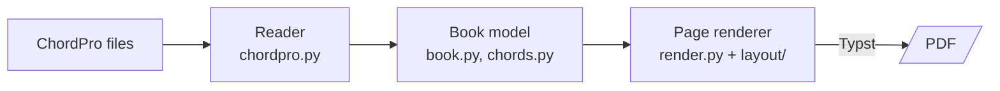

# Architecture

How StrumBook is built. Diagrams are Mermaid, so GitHub renders them. Update this in
the same PR as any change to the structure.

## Context

StrumBook runs on the book maker's own computer (Windows, macOS or Linux). It reads
songs from one or more collection repositories and writes PDF books. It makes no
network requests.

## Building a book

`strumbook build SONGS_DIR -o BOOK.pdf` reads one folder of songs and writes one PDF
([ADR-0002](adr/0002-chordpro-format-typst-renderer.md)):

- **Reader** (`chordpro.py`) reads the ChordPro subset we use: title, sort title,
  artist, subtitle, credits, verses, choruses and inline chords. Credits come from
  `{words}`, `{music}` and `{translation}` and the variants real collections use
  (`{text}`, `{translated}`, `{Latin Text}` …). Metadata we don't show (key, capo …)
  and known oddities are ignored; other directives are skipped with a warning.
- **Book model** (`book.py`) sorts the songs by sort title, ignoring case, and groups each
  song's chords into diagrams: chords with the same fingering share one. Shapes come
  from our own GCEA table (`chords.json`, read by `chords.py`). It also holds the two
  rules for dropping a song's diagram column (`show_diagrams`). It knows nothing about
  pages.
- **Page renderer** (`render.py`) is the only code that knows about Typst. It passes
  the book to `layout/book.typ` as JSON data, never as Typst markup, in three offline
  passes: outline the chord names to SVG (`layout/chord-names.typ`) so they stay out
  of the searchable text, measure each song with and without diagrams and apply the
  rules, then compile the book: title page, index, songs, reference page and Credits.
  The font, Atkinson Hyperlegible, is bundled in `layout/fonts/`; system fonts are
  ignored, so books look the same everywhere.
- **CLI** (`cli.py`) prints warnings and errors as one line each, with no traceback.
  `python -m strumbook` runs the same code.

## Planned

To be built issue by issue: book definitions that pick songs from several collections,
the RHS layout and build options, baritone (DGBE) diagrams, and a separate **importer**
that drafts ChordPro from PDFs or pasted chords-over-lyrics text, for a person to
check. Add modules when an issue needs them, not before.
