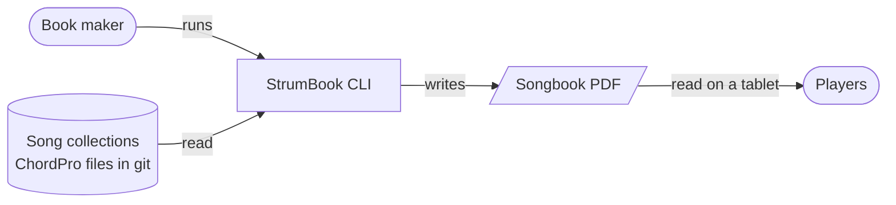
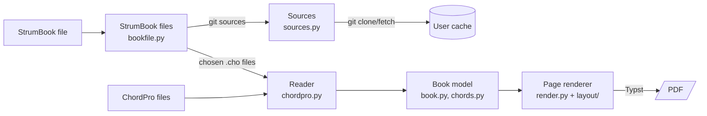

# Architecture

How StrumBook is built. Diagrams are Mermaid, so GitHub renders them. Update this in
the same PR as any change to the structure.

## Context

StrumBook runs on the book maker's own computer (Windows, macOS or Linux). It reads
songs from one or more collection repositories and writes PDF books. Its only network
use is the system's `git` fetching a StrumBook file's `git` sources.

## Building a book

`strumbook build BOOK.strumbook.toml -o BOOK.pdf` builds the book a
[StrumBook file](strumbook-files.md) describes
([ADR-0003](adr/0003-strumbook-files.md)); `strumbook build SONGS_DIR` is the shortcut
for every song in one folder. Either way it writes one PDF
([ADR-0002](adr/0002-chordpro-format-typst-renderer.md)):

- **StrumBook files** (`bookfile.py`) are read with `tomllib`, checked, each source
  resolved to a folder, and the songs chosen (`include`, `pick` and `exclude` for a
  song library; sets, `pick` and `spares` for a set list); it returns the book with the
  file's `[build]` settings. Unknown keys are warnings. It also holds each type's
  default settings (`TYPES`).
- **Sources** (`sources.py`) clone a `git` source into the user cache with the system's
  `git`, fetch the latest or check out the `pin`, and fall back to the cached copy with
  a warning when offline. Only `https` and ssh addresses reach `git`, after `--`.

- **Reader** (`chordpro.py`) reads the ChordPro subset we use: title, sort title,
  artist, subtitle, credits, verses, choruses and inline chords. Credits come from
  `{words}`, `{music}` and `{translation}` and the variants real collections use
  (`{text}`, `{translated}`, `{Latin Text}` …). Metadata we don't show (key, capo …)
  and known oddities are ignored; other directives are skipped with a warning.
- **Book model** (`book.py`) sorts the songs by sort title, ignoring case (a set list
  keeps its running order and records its sets and spares as `Section`s over it). It
  groups chords into diagrams in a tuning (`group_diagrams`): chords with the same
  fingering share one. Shapes come from our own table for each tuning
  (`chords-gcea.json`, `chords-dgbe.json`, read by `chords.py`, which also simplifies
  slash chords and reads `chord-notes.json`, the fixed notes in each chord). It also
  holds the chord chart's roots and types (`chord_chart`) and the two rules for
  dropping a song's diagram column (`show_diagrams`); with `chords` off, the renderer
  drops every column. It knows nothing about pages.
- **Page renderer** (`render.py`) is the only code that knows about Typst. It prints
  each chord name as the `slash-chords` setting says, asks the book model for the
  diagrams in the book's tuning, and passes the book to `layout/book.typ` as JSON
  data, never as Typst markup, in three offline passes: outline the chord names to
  SVG (`layout/chord-names.typ`) so they stay out of the searchable text, measure
  each song with and without diagrams and apply the rules, then compile the book:
  title page, index, songs, Reference (a chord chart per listed tuning, then the
  notes in each chord) and Credits, or for a set list a running-order page and a
  break page before each set. Each part can be turned off. The index is always A to Z. `render.py` works out
  the link strip's cells: letters for a song library, set names for a set list, or
  none. The notes in each chord are the one place chord names are real text, so a
  search for one such as "Am7" finds that page; in songs they never are.
  The font, Atkinson Hyperlegible, is bundled in `layout/fonts/`; it has no sharp or
  flat signs, so ♯ and ♭ come from Libertinus Serif, which Typst bundles. System
  fonts are ignored, so books look the same everywhere.
- **CLI** (`cli.py`) layers the settings (the type's defaults, then the StrumBook
  file's `[build]`, then command-line options) and prints warnings and errors as one
  line each, with no traceback. With `chords` off it leaves out the "no diagram"
  warnings (`Book.missing_diagrams`). `python -m strumbook` runs the same code.

## Planned

To be built issue by issue: the RHS layout and build options, and a separate
**importer** that drafts ChordPro from PDFs or pasted chords-over-lyrics text, for a
person to check. Add modules when an issue needs them, not before.
