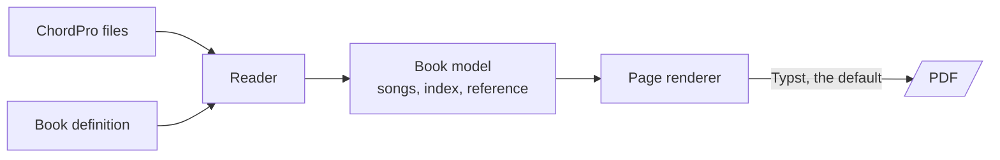

# Architecture

How StrumBook is built. Diagrams are Mermaid, so GitHub renders them. Update this in
the same PR as any change to the structure.

## Context

StrumBook runs on the book maker's own computer (Windows, macOS or Linux). It reads
songs from one or more collection repositories and writes PDF books. It makes no
network requests.

## Today

Only the command-line entry point exists: `src/strumbook/cli.py` shows help and the
version. `python -m strumbook` runs the same code.

## Planned shape

Agreed direction ([ADR-0002](adr/0002-chordpro-format-typst-renderer.md)), to be built
issue by issue:

- **Reader** parses ChordPro and a book definition into a **book model**: songs in
  order, index entries and reference pages. It knows nothing about pages.
- **Page renderer** turns the book model into a PDF. Typst is the default and, for
  now, the only one; the boundary lets another be added later.
- **Importer** (separate): drafts ChordPro from PDFs or pasted chords-over-lyrics text,
  for a person to check.

Add modules when an issue needs them, not before.
