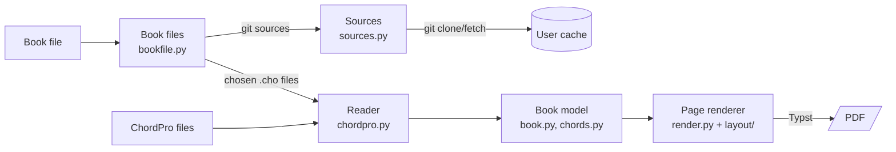

# Architecture

How StrumBook is built. Diagrams are Mermaid, so GitHub renders them. Update this in
the same PR as any change to the structure.

## Context

StrumBook runs on the book maker's own computer (Windows, macOS or Linux). It reads
songs from one or more collection repositories and writes PDF books. Its only network
use is the system's `git` fetching a book file's `git` sources.

## Building a book

`strumbook build BOOK.book.toml -o BOOK.pdf` builds the book a
[book file](book-files.md) describes; `strumbook build SONGS_DIR` is the shortcut for
every song in one folder. Either way it writes one PDF
([ADR-0002](adr/0002-chordpro-format-typst-renderer.md)):

- **Book files** (`bookfile.py`) read the TOML with `tomllib`, check it, resolve each
  source to a folder, choose the songs (`include`, `pick`, `exclude` and `order` for a
  songbook; sets, `pick` and `spares` for a set list) and return the book with the
  file's `[build]` settings. Unknown keys are warnings. It also holds each style's
  default settings (`STYLES`).
- **Sources** (`sources.py`) clone a `git` source into the user cache with the system's
  `git`, fetch the latest or check out the `pin`, and fall back to the cached copy with
  a warning when offline. Only `https` and ssh addresses reach `git`, after `--`.

- **Reader** (`chordpro.py`) reads the ChordPro subset we use: title, sort title,
  artist, subtitle, credits, verses, choruses and inline chords. Credits come from
  `{words}`, `{music}` and `{translation}` and the variants real collections use
  (`{text}`, `{translated}`, `{Latin Text}` …). Metadata we don't show (key, capo …)
  and known oddities are ignored; other directives are skipped with a warning.
- **Book model** (`book.py`) sorts the songs by sort title, ignoring case (unless a
  book file lists them in running order), records a set list's sets and spares as
  `Section`s over that order, and groups each
  song's chords into diagrams: chords with the same fingering share one. Shapes come
  from our own GCEA table (`chords.json`, read by `chords.py`). It also holds the two
  rules for dropping a song's diagram column (`show_diagrams`). It knows nothing about
  pages.
- **Page renderer** (`render.py`) is the only code that knows about Typst. It passes
  the book to `layout/book.typ` as JSON data, never as Typst markup, in three offline
  passes: outline the chord names to SVG (`layout/chord-names.typ`) so they stay out
  of the searchable text, measure each song with and without diagrams and apply the
  rules, then compile the book: title page, index, songs, reference page and Credits,
  or for a set list a running-order page and a break page before each set. Each part
  can be turned off. The index is always A to Z. `render.py` works out the link
  strip's cells: letters for an A-to-Z songbook, set names for a set list, or none.
  The font, Atkinson Hyperlegible, is bundled in `layout/fonts/`; system fonts are
  ignored, so books look the same everywhere.
- **CLI** (`cli.py`) layers the settings (the style's defaults, then the book file's
  `[build]`, then command-line options) and prints warnings and errors as one line
  each, with no traceback. `python -m strumbook` runs the same code.

## Planned

To be built issue by issue: the RHS layout and build options, baritone (DGBE)
diagrams, and a separate **importer** that drafts ChordPro from PDFs or pasted
chords-over-lyrics text, for a person to check. Add modules when an issue needs them,
not before.
